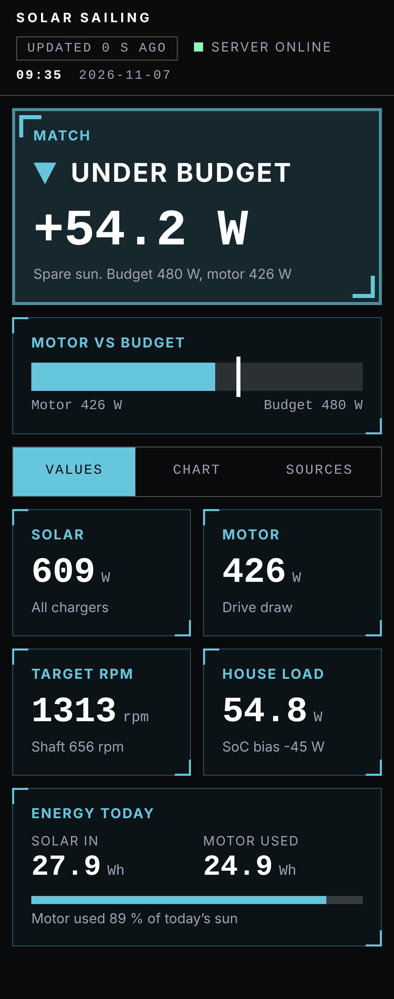
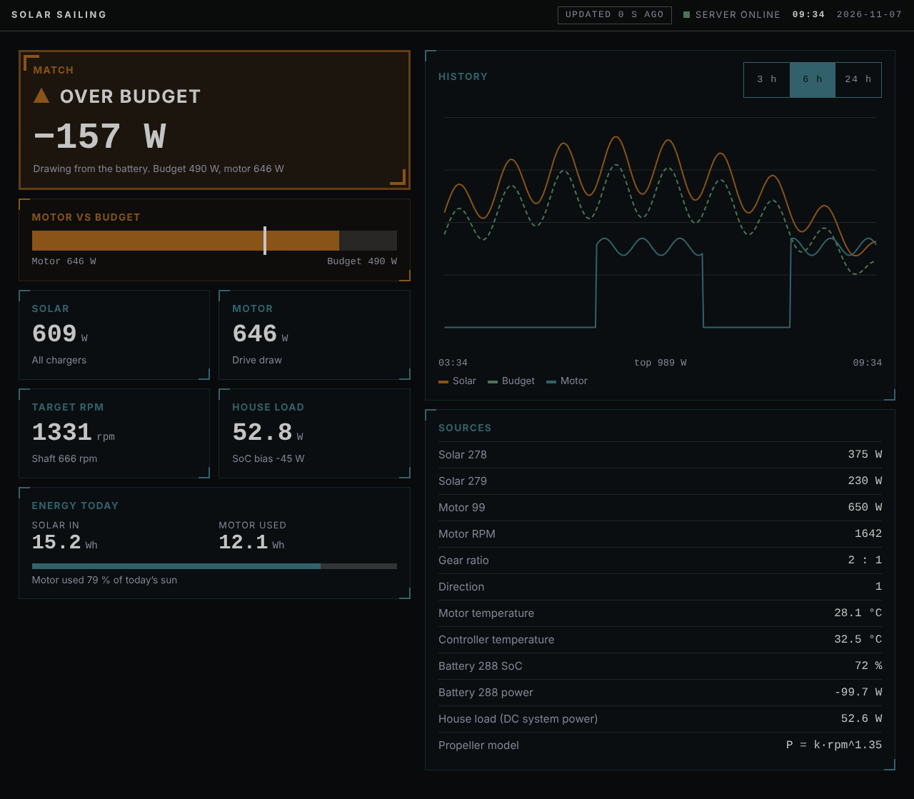
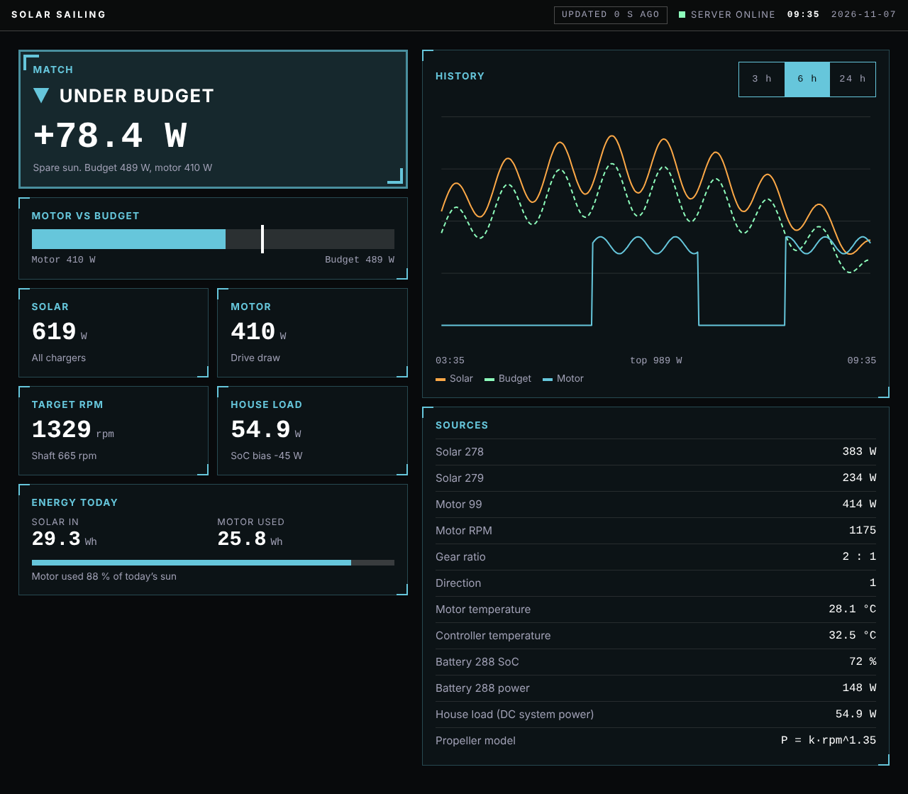
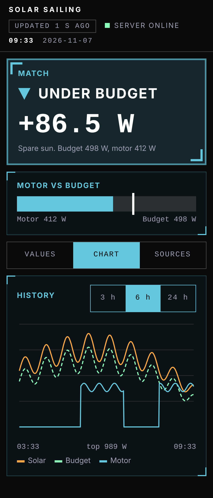
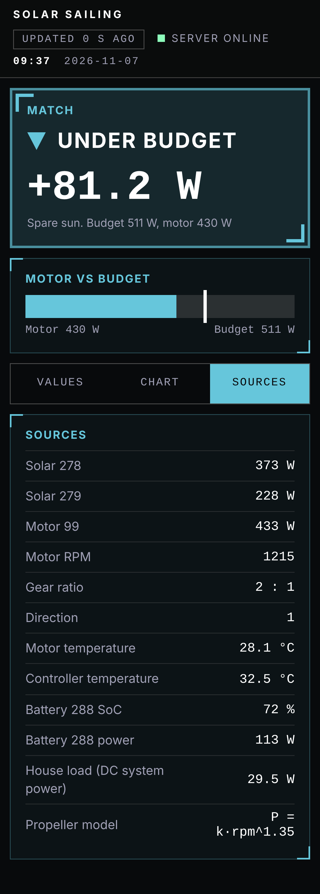
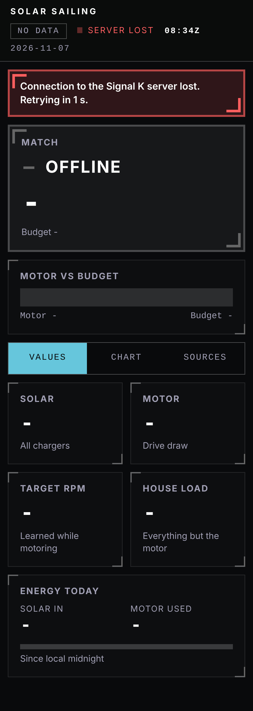

# Solar Sailing (signalk-solar-sailing)

A [Signal K](https://signalk.org) server plugin for electric-drive boats. It
shows how much power the sun delivers, how much the motor draws, and what motor
power (and roughly what RPM) the boat can sustain on solar alone, so you can
motor "on the sun" without slowly draining the house bank.

It is **advisory**: it publishes a solar budget, a match state and a target RPM,
and raises a notification when the motor stays over budget. It never commands
the motor.




## Requirements

- Signal K server 2.14 or newer, Node 22 or newer.
- Motor, solar and battery data, for example from
  [signalk-venus-plugin](https://www.npmjs.com/package/signalk-venus-plugin)
  on a Victron Cerbo GX. Target RPM needs the motor's `propulsion.<id>.revolutions`
  (venus plugin PR #210).
- Optional: a History API provider such as
  [signalk-questdb](https://www.npmjs.com/package/signalk-questdb), so today's
  energy survives restarts.

## How it works

Every second while the motor is in drive (every 10 s otherwise) the plugin
reads the current values and computes:

- **Solar input**: sum of every `electrical.solar.*` charger, falling back to
  `electrical.venus.totalPanelPower`. Stale data means *unknown*, never 0 W.
- **House load**: DC system power minus motor (`electrical.venus.dcPower`), else
  the battery balance `solar − battery − motor`, else a configured constant.
- **Solar budget**: `solar − house load + SoC bias`, smoothed (30 s) and clamped
  to `[0, max motor power]`.
- **Match state**: `matched`, `over`, `under` (tolerance max(50 W, 10 %)), or
  `unknown` when the motor is not in drive or data is missing.
- **Target RPM**: from a propeller model `P = k · rpmⁿ` that it learns while
  you motor at steady speeds.

## Webapp

The plugin serves a cockpit dashboard at `/signalk-solar-sailing/` (it also
appears in the server's webapp list):

- match state as a word and icon with the balance, and a motor-vs-budget bar
- solar, motor, target RPM (and shaft RPM with a gear ratio), house load
- energy today, a 3 / 6 / 24 h chart, and a per-source breakdown

It follows the boat's dark "tactical console" style: dark in day and night
mode (from `environment.mode`), state colours only on fresh data and grey with
a dash when data is missing or stale, single column with tabs on a phone, a
grid on the nav-station screen. It needs nothing from the internet and runs on
**Chromium 69**, so it also works in a Navico / B&G chart plotter's browser:
open the same URL there.

With Signal K security on, enable read-only access (`allow_readonly`) or sign
in; otherwise the page shows the offline banner.

| | |
|---|---|
|  |  |
|  |  |

The screenshots were taken on a development server with simulated data; the
chart history is synthetic. `desktop-no-history.png` shows the chart without
a history provider.

## Published paths

All on the self vessel, in SI units with `meta.units`:

| Path | Units |
|------|-------|
| `plugin.solarsailing.solarPower` | W |
| `plugin.solarsailing.houseLoad` | W |
| `plugin.solarsailing.socBias` | W |
| `plugin.solarsailing.budget` | W |
| `plugin.solarsailing.motorPower` | W |
| `plugin.solarsailing.balance` | W |
| `plugin.solarsailing.matchState` | `matched` / `over` / `under` / `unknown` |
| `plugin.solarsailing.targetRevolutions` | Hz |
| `plugin.solarsailing.targetShaftRevolutions` | Hz (only with a gear ratio) |
| `plugin.solarsailing.solarEnergyToday` | J |
| `plugin.solarsailing.motorEnergyToday` | J |

Notification `notifications.solarsailing.overBudget` (`warn`) when the motor
stays over budget for 60 s while in drive.

A status snapshot with a per-source breakdown is readable at
`/signalk/v2/api/resources/solar-sailing/status`.

## Configuration

Everything has a default; the settings you are most likely to change:

- **Propulsion path**: default `propulsion.main`. The venus plugin publishes a
  Curtis controller as `propulsion.99`, so set that here (or map it to `main`).
- **Gear ratio**: set `<propulsion path>.transmission.gearRatio` (motor turns
  per shaft turn) in the server's `baseDeltas.json` to also get target shaft RPM.
- **Battery bank id** and **invert battery power sign**.
- **Max motor power**: clamps the budget.
- **Path overrides** for solar, motor power and battery on non-Victron boats.
- **Reset learned propeller** after a prop change.

## Development

```sh
npm install
npm test
npm run lint
npm run typecheck
# webapp screenshots against a development server with simulated data
node scripts/screenshots.mjs http://localhost:3000/signalk-solar-sailing/ desktop-day desktop history
```

Design documents: [SPEC](docs/SPEC.md), [ARCHITECTURE](docs/ARCHITECTURE.md),
[build plans](docs/plans/00-roadmap.md).

## Licence

[EUPL-1.2](LICENSE)
