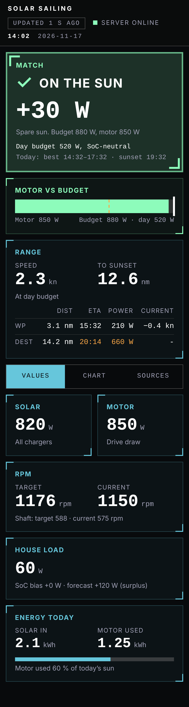
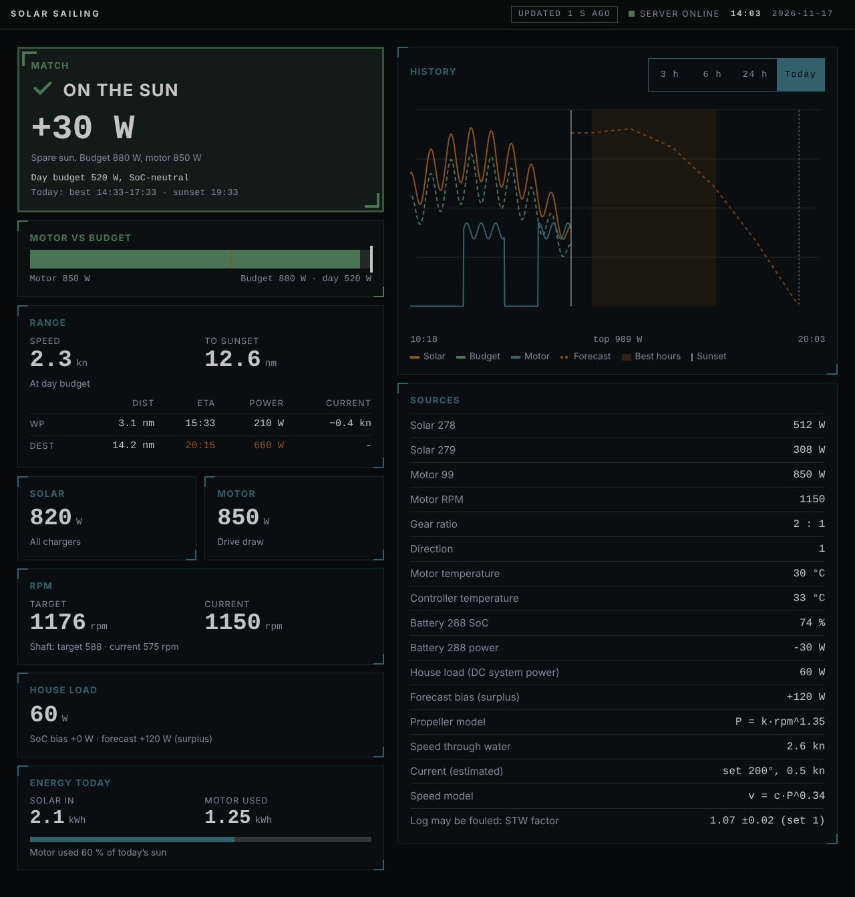
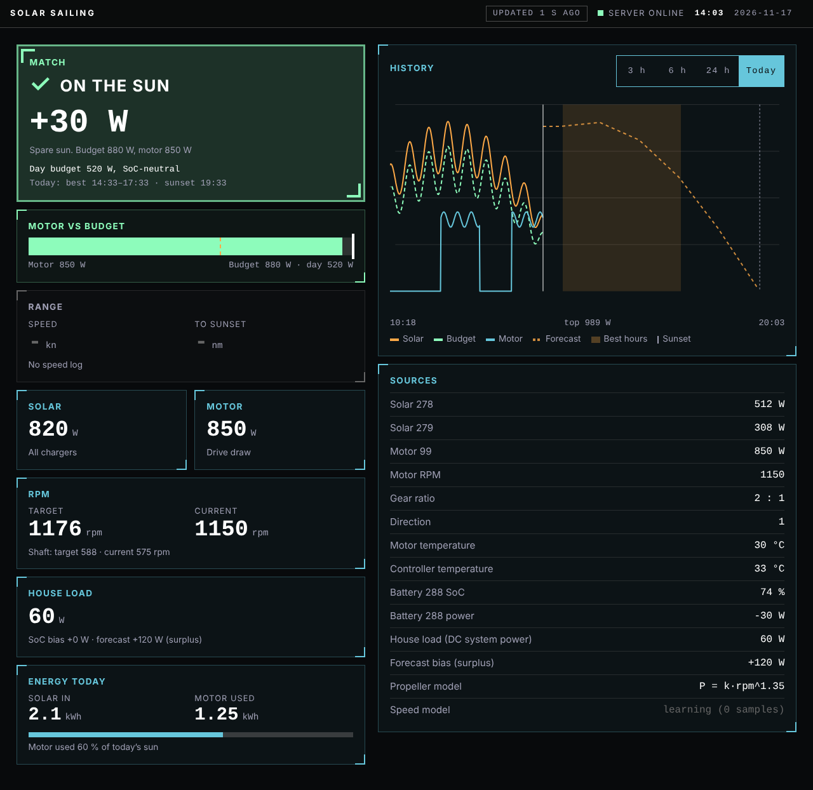
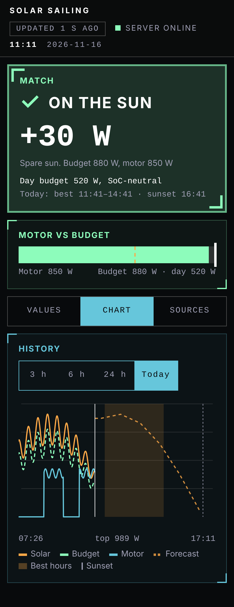
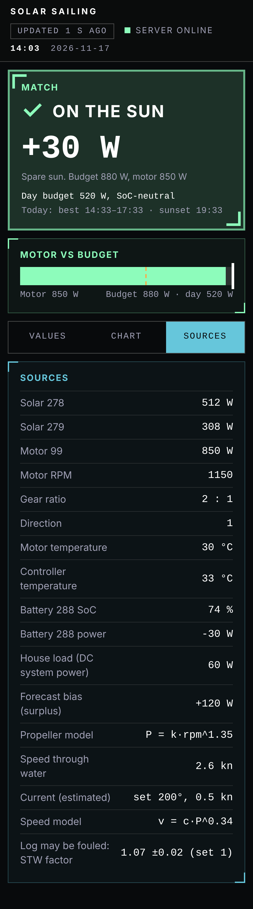
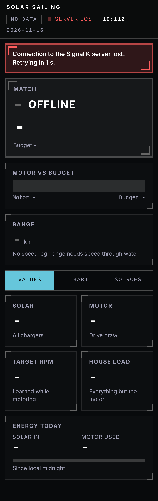

# Solar Sailing (signalk-solar-sailing)

A [Signal K](https://signalk.org) server plugin for electric-drive boats. It
shows how much power the sun delivers, how much the motor draws, and what motor
power (and roughly what RPM) the boat can sustain on solar alone, so you can
motor "on the sun" without slowly draining the house bank.

It is **advisory**: it publishes a solar budget, a match state and a target RPM,
and raises a notification when the motor stays over budget. It never commands
the motor.




## Requirements

- Signal K server 2.14 or newer, Node 22 or newer.
- Motor, solar and battery data, for example from
  [signalk-venus-plugin](https://www.npmjs.com/package/signalk-venus-plugin)
  on a Victron Cerbo GX. Target RPM needs the motor's `propulsion.<id>.revolutions`
  (venus plugin PR #210).
- Optional: a History API provider such as
  [signalk-questdb](https://www.npmjs.com/package/signalk-questdb), so today's
  energy survives restarts.
- Optional: [signalk-energy-predictor](https://www.npmjs.com/package/@meri-imperiumi/signalk-energy-predictor)
  for a solar forecast (day budget, forecast bias, best hours), and a GPS
  position for the sunset time. Without them those values are simply
  unknown; everything else works the same.
- Optional: a speed log (`navigation.speedThroughWater`) for the speed and
  range estimate, and an active course (course-provider, bundled with the
  server) for waypoint and destination ETAs.

## How it works

Every second while the motor is in drive (every 10 s otherwise) the plugin
reads the current values and computes:

- **Solar input**: sum of every `electrical.solar.*` charger, falling back to
  `electrical.venus.totalPanelPower`. Stale data means *unknown*, never 0 W.
- **House load**: DC system power minus motor (`electrical.venus.dcPower`), else
  the battery balance `solar − battery − motor`, else a configured constant.
- **Solar budget**: `solar − house load + SoC bias`, smoothed (30 s) and clamped
  to `[0, max motor power]`.
- **Match state**: `matched`, `over`, `under` (tolerance max(50 W, 10 %)), or
  `unknown` when the motor is not in drive or data is missing.
- **Target RPM**: from a propeller model `P = k · rpmⁿ` that it learns while
  you motor at steady speeds.

With a solar forecast from signalk-energy-predictor it also computes:

- **Forecast bias** on the solar budget: up to +300 W while the forecast says
  the bank will fill anyway (solar that would be curtailed), −100 W on
  `deficit`, −200 W on `critical`.
- **Day budget**: the steady motor power that uses the forecast solar until
  sunset. By default it ends the day where the bank is now (SoC-neutral);
  set a **sunset target SoC** to aim at a charge level at sunset instead, so
  a full bank can be spent on the way and a low one is refilled. The target
  is raised if needed so the bank gets through the night above the minimum
  SoC.
- **Best hours** to motor today: the 3 h window before sunset with the most
  forecast surplus.
- **Sunset** from the boat's position (or from the forecast without one).

With a speed log it learns how fast the boat goes for a given motor power
(`v = c · Pᵐ`, from steady motoring, never while sailing) and computes:

- **Speed at budget** and **range until sunset** at the day budget (or the
  live budget without a forecast), through the water.
- With an active course: **ETA** at the next waypoint and at the final
  destination, and the **motor power needed** to arrive by sunset. The next
  waypoint allows for the current (set and drift from `environment.current`,
  or estimated from GPS track, speed log and heading); the final destination
  of a route does not, because the current changes along the way.

The range stays hidden until the model has 30 steady samples, unless you set
a fallback `c`. A fouled paddlewheel reads low: set the **STW correction
factor**; the status resource suggests one from SOG/STW over several
headings.

## Webapp

The plugin serves a cockpit dashboard at `/signalk-solar-sailing/` (it also
appears in the server's webapp list):

- match state as a word and icon with the balance, and a motor-vs-budget bar
- solar, motor, target RPM (and shaft RPM with a gear ratio), house load
- energy today, a 3 / 6 / 24 h chart, and a per-source breakdown

It follows the boat's dark "tactical console" style: dark in day and night
mode (from `environment.mode`), state colours only on fresh data and grey with
a dash when data is missing or stale, single column with tabs on a phone, a
grid on the nav-station screen. It needs nothing from the internet and runs on
**Chromium 69**, so it also works in a Navico / B&G chart plotter's browser:
open the same URL there.

With Signal K security on, enable read-only access (`allow_readonly`) or sign
in; otherwise the page shows the offline banner.

| | |
|---|---|
|  |  |
|  |  |

The screenshots were taken on a development server with simulated data; the
chart history is synthetic. `desktop-no-history.png` shows the chart without
a history provider.

## Published paths

All on the self vessel, in SI units with `meta.units`:

| Path | Units |
|------|-------|
| `plugin.solarsailing.solarPower` | W |
| `plugin.solarsailing.houseLoad` | W |
| `plugin.solarsailing.socBias` | W |
| `plugin.solarsailing.budget` | W |
| `plugin.solarsailing.motorPower` | W |
| `plugin.solarsailing.balance` | W |
| `plugin.solarsailing.matchState` | `matched` / `over` / `under` / `unknown` |
| `plugin.solarsailing.targetRevolutions` | Hz |
| `plugin.solarsailing.targetShaftRevolutions` | Hz (only with a gear ratio) |
| `plugin.solarsailing.solarEnergyToday` | J |
| `plugin.solarsailing.motorEnergyToday` | J |
| `plugin.solarsailing.forecastBias` | W |
| `plugin.solarsailing.dayBudget` | W |
| `plugin.solarsailing.dayBudgetBasis` | `target` / `neutral` |
| `plugin.solarsailing.sunsetTargetSoc` | ratio |
| `plugin.solarsailing.solarRemaining` | J (forecast, until sunset) |
| `plugin.solarsailing.houseRemaining` | J (forecast, until sunset) |
| `plugin.solarsailing.sunset` | ISO 8601 time |
| `plugin.solarsailing.bestHoursStart` / `bestHoursEnd` | ISO 8601 time |
| `plugin.solarsailing.speedAtBudget` | m/s |
| `plugin.solarsailing.rangeUntilSunset` | m |
| `plugin.solarsailing.rangeBasis` | `dayBudget` / `budget` |
| `plugin.solarsailing.waypointEta` / `destinationEta` | ISO 8601 time |
| `plugin.solarsailing.waypointRequiredPower` / `destinationRequiredPower` | W |
| `plugin.solarsailing.currentSetTrue` | rad |
| `plugin.solarsailing.currentDrift` / `waypointCurrent` | m/s |

Unknown values are published as `null`.

Notification `notifications.solarsailing.overBudget` (`warn`) when the motor
stays over budget for 60 s while in drive.

A status snapshot with a per-source breakdown is readable at
`/signalk/v2/api/resources/solar-sailing/status`.

## Configuration

Everything has a default; the settings you are most likely to change:

- **Propulsion path**: default `propulsion.main`. The venus plugin publishes a
  Curtis controller as `propulsion.99`, so set that here (or map it to `main`).
- **Gear ratio**: set `<propulsion path>.transmission.gearRatio` (motor turns
  per shaft turn) in the server's `baseDeltas.json` to also get target shaft RPM.
- **Battery bank id** and **invert battery power sign**.
- **Max motor power**: clamps the budget.
- **Path overrides** for solar, motor power and battery on non-Victron boats.
- **Reset learned propeller** after a prop change.
- **Sunset target SoC** (default 0 = off) and **battery capacity** (default
  14 500 Wh, the reference boat's bank: **set your own**, or 0 to use the
  bank's `capacity.nominal`). The capacity only matters once a target is set.
- **Use solar forecast**, its path, and the surplus assist cap and deficit /
  critical reserves.
- **Speed through water path**, **STW correction factor** (default 1.0) and
  **reset learned speed model** (for example after cleaning the hull).

## Development

```sh
npm install
npm test
npm run lint
npm run typecheck
# webapp screenshots against a development server with simulated data
node scripts/screenshots.mjs http://localhost:3000/signalk-solar-sailing/ desktop-day desktop history
```

Design documents: [SPEC](docs/SPEC.md), [ARCHITECTURE](docs/ARCHITECTURE.md),
[build plans](docs/plans/00-roadmap.md).

## Licence

[EUPL-1.2](LICENSE)
